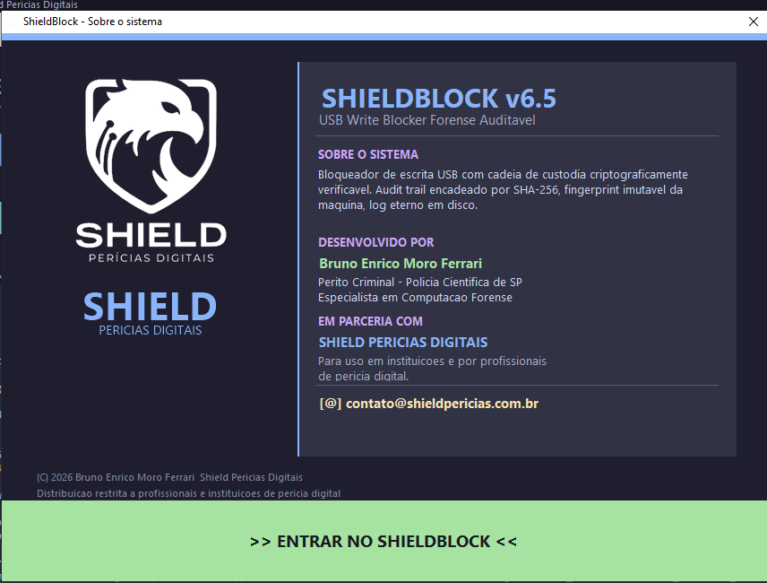
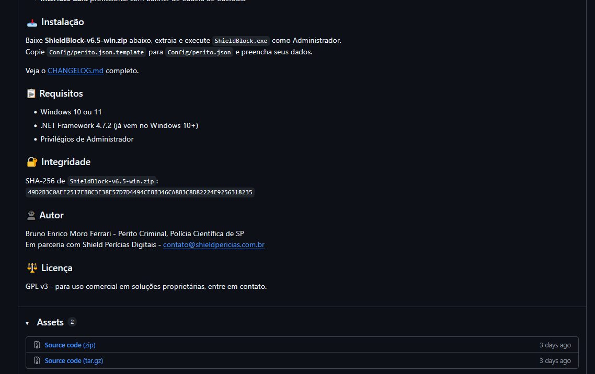
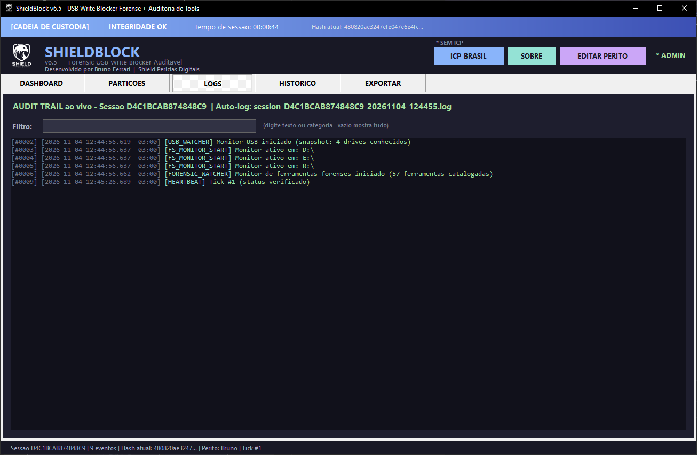
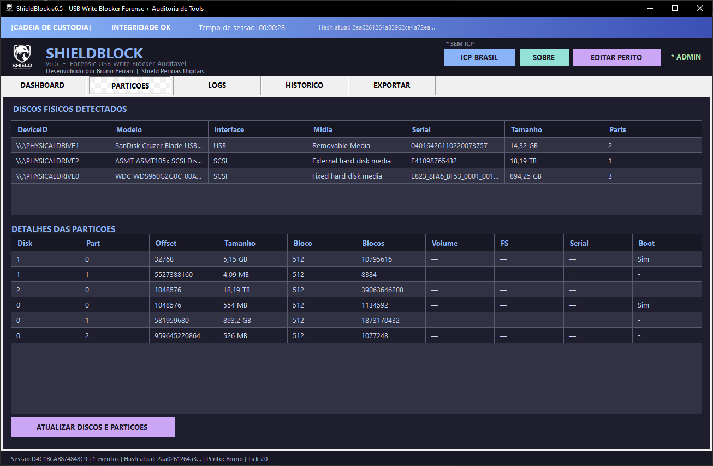
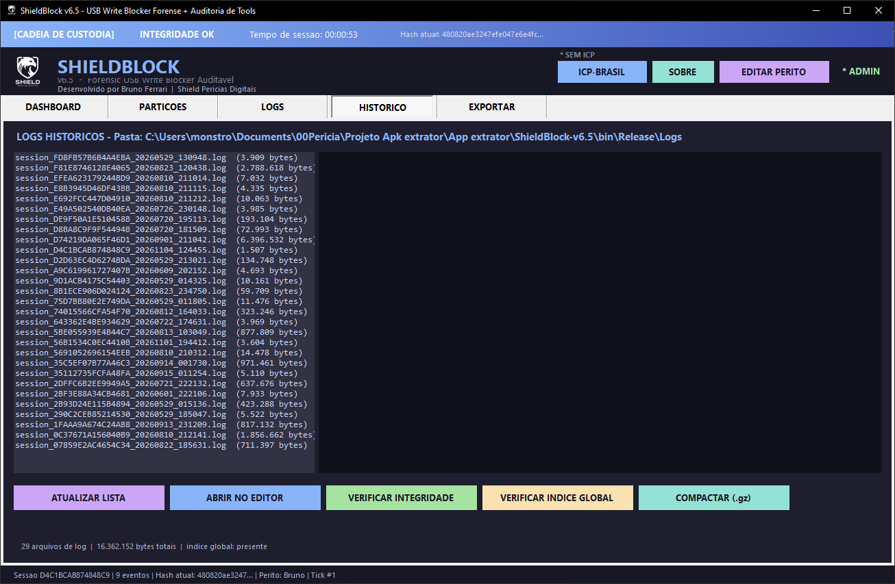
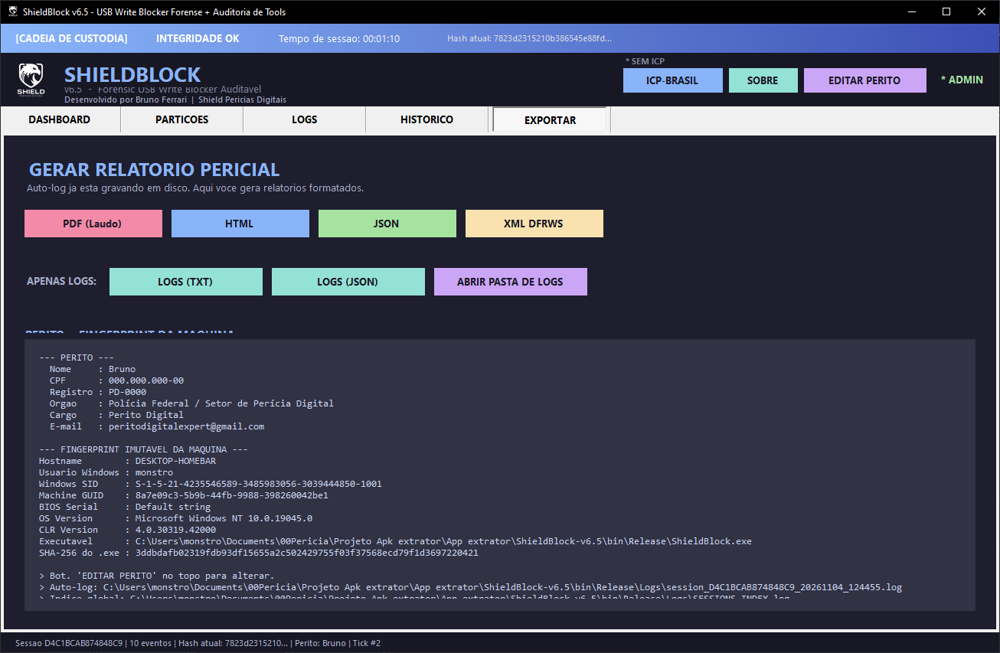
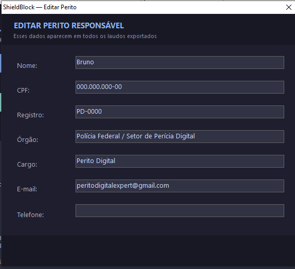
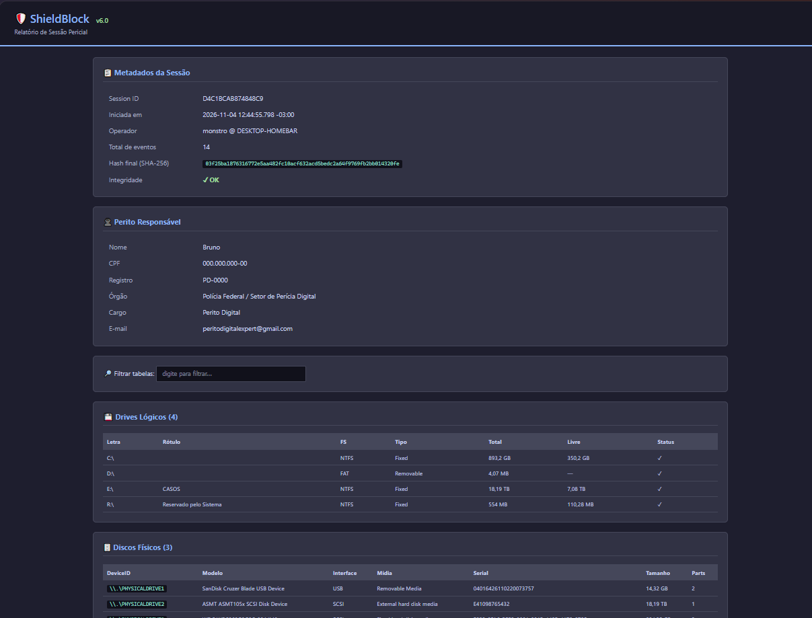
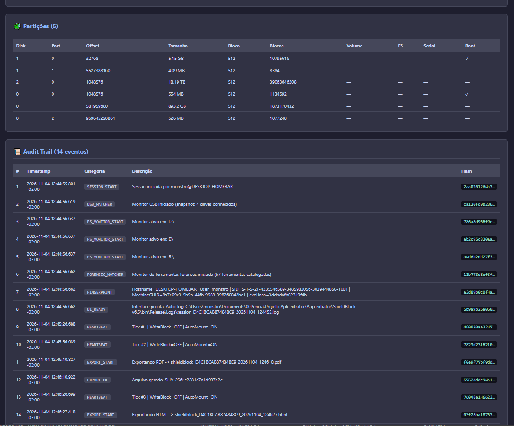

<p align="center">
  
</p>

<h1 align="center">ShieldBlock</h1>

<p align="center">
  <strong>USB Write Blocker Forense Auditável com Cadeia de Custódia Criptográfica e Assinatura Digital ICP-Brasil</strong>
</p>

<p align="center">
  
  
  
  
  
  
</p>

---

## 🎯 O que é

**ShieldBlock** é um bloqueador de escrita USB para análise forense digital que registra toda a sessão em um audit trail **criptograficamente verificável** (SHA-256 encadeado estilo blockchain) e opcionalmente **assinado com certificado digital ICP-Brasil** (e-CPF ou e-CNPJ, A1 ou A3).

Projetado para peritos criminais, investigadores digitais, instituições de perícia pública e privada que precisam de **validade jurídica plena** (Lei 14.063/2020 + MP 2.200-2/2001) nas suas coletas.

## ✨ Features principais

### 🛡️ Proteção
- **Write Block via Registry** (`HKLM\...\StorageDevicePolicies\WriteProtect`)
- **AutoMount control** via `mountvol.exe /N` (efeito imediato)
- **Limpar cache de drives** (`mountvol /R`) — Windows "esquece" drives conhecidos
- **Tamper detection** nas chaves de Registry (detecta alterações externas)

### 📝 Auditoria
- **Audit trail SHA-256 encadeado** — qualquer adulteração quebra a cadeia
- **Auto-log em disco** — cada evento gravado IMEDIATAMENTE (FileStream + AutoFlush)
- **Índice global append-only** (`SESSIONS_INDEX.log`) — todas as sessões já abertas
- **Fingerprint imutável** da máquina (Hash do .exe + Machine GUID + SID + BIOS Serial)
- **Heartbeat 30s** com verificação periódica

### 👁️ Monitoramento em tempo real
- **UsbWatcher** (WMI `Win32_VolumeChangeEvent`) — detecta plug/unplug com modelo + serial
- **ForensicToolWatcher** — detecta launch de **70+ ferramentas forenses** (FTK Imager, Autopsy, X-Ways, EnCase, Magnet AXIOM, Cellebrite UFED, Volatility, Wireshark, HxD, dd/dcfldd, OSForensics, Belkasoft, KAPE) e **anti-forenses** (CCleaner, BleachBit, Eraser, VeraCrypt)
- **FileSystemMonitor** em drives não-system
- **ProcessAuditor** periódico

### 🔐 Validade jurídica (ICP-Brasil)
- **Assinatura PKCS#7/CAdES-BES** com SHA-256 e cadeia X.509 completa
- Suporte a **e-CPF e e-CNPJ**, **A1 (.pfx)** e **A3 (smartcard/token)**
- Extração automática de **CPF/CNPJ/Razão Social** do certificado (OIDs ICP-Brasil)
- **Carimbo de tempo RFC 3161** (ACT-ITI gratuita) — implementação ASN.1 manual
- Gera `.p7s` detached ao lado do `.log` de cada sessão

### 📤 Exportação
- **PDF** com layout rico (boxes coloridos, tabelas, header/footer, hash SHA-256)
- **HTML interativo** com filtro de busca
- **JSON estruturado** (integração Autopsy, X-Ways)
- **XML DFRWS compatível**
- **Exportar só logs** (TXT + JSON)

### 🎨 Interface
- **Dark theme Catppuccin Mocha**
- Logo real da Shield Perícias (PNG) no splash e header
- **Banner CADEIA DE CUSTÓDIA** sempre visível: integridade + timer + hash atual
- Cards verde/vermelho para WriteBlock e AutoMount
- Splash com créditos do autor

## 📸 Screenshots

| Splash + Créditos | Dashboard | Audit Trail (LOGS) |
|---|---|---|
|  |  |  |

| Partições e Discos Físicos | Histórico de Sessões |
|---|---|
|  |  |

| Exportar (Perito + Fingerprint) | Editar Perito |
|---|---|
|  |  |

| Relatório HTML - Metadados e Perito | Relatório HTML - Audit Trail |
|---|---|
|  |  |

## 🚀 Instalação

### Pré-requisitos
- Windows 10 ou 11
- .NET Framework 4.7.2 (já vem no Windows 10+)
- Privilégios de Administrador (necessário pro Registry e `mountvol.exe`)

### Opção 1: Download do executável (recomendado)

Baixe o `ShieldBlock-v6.5.zip` da página de [Releases](../../releases) e extraia.

Execute `ShieldBlock.exe` (vai pedir UAC automaticamente).

### Opção 2: Compilar do código

```cmd
git clone https://github.com/peritobrunoferrari/ShieldBlock.git
cd ShieldBlock
COMPILAR.bat
```

O script detecta MSBuild do Visual Studio automaticamente; se não achar, usa `csc.exe` nativo do .NET Framework. Nenhuma dependência externa, zero NuGet.

### Configuração inicial

1. Copie `Config/perito.json.template` para `Config/perito.json`
2. Edite com seus dados (nome, CPF, registro, órgão)
3. Para ICP-Brasil: abra o app → botão "ICP-BRASIL" no header → selecione seu certificado → TESTAR ASSINATURA

## 🔧 Como usar (fluxo pericial)

1. **Executar como Administrador** (UAC pede automático)
2. Clicar **HABILITAR WRITE BLOCK** → card vira verde 🟢
3. Clicar **DESABILITAR AUTOMOUNT** → card vira verde 🟢
4. (Opcional) Clicar **LIMPAR CACHE DE DRIVES** → Windows esquece drives
5. Plugar a evidência USB
6. Analisar com sua ferramenta forense preferida
7. Ao final, exportar laudo em PDF
8. Fechar o app → auto-log grava SESSION_END + assinatura ICP (se configurada)

Todos os eventos são gravados **em tempo real** em `Logs/session_<id>_<timestamp>.log`.

## 🏗️ Arquitetura

```
src/
├── Program.cs                       Entry point + ErrorHandler
├── Core/                            Lógica central
│   ├── ShieldBlockEngine.cs         Registry + mountvol
│   ├── LogSession.cs                Audit trail SHA-256 encadeado
│   ├── AutoLogger.cs                Grava eventos em disco em tempo real
│   ├── SessionRegistry.cs           Índice global append-only
│   ├── UsbWatcher.cs                WMI Win32_VolumeChangeEvent
│   ├── RegistryTamperGuard.cs       Tamper detection
│   ├── FileSystemMonitor.cs         FileSystemWatcher
│   ├── ProcessAuditor.cs            Snapshot de processos
│   ├── HeartbeatService.cs          Timer 30s
│   ├── ForensicToolWatcher.cs       70+ tools catalogadas
│   ├── DriveDetector.cs             Enum drives lógicos
│   ├── PartitionAnalyzer.cs         WMI Win32_DiskPartition
│   ├── PeritoConfig.cs              Metadados do perito
│   └── Theme.cs                     Paleta Catppuccin
├── Utils/
│   ├── HashUtility.cs               SHA-256 (sem Convert.ToHexString)
│   ├── Iso8601.cs                   Timestamps com timezone
│   └── MachineFingerprint.cs        Hash exe + SID + GUID + BIOS
├── Icp/                             ICP-Brasil (v6.5)
│   ├── IcpBrasilCertificate.cs      Parse OIDs ICP (CPF, CNPJ)
│   ├── IcpBrasilSigner.cs           PKCS#7 CAdES-BES
│   ├── IcpTimestampClient.cs        RFC 3161 manual
│   └── IcpBrasilConfig.cs           Persistência
├── Export/
│   ├── PdfExporter.cs               PDF puro em C# (sem lib externa)
│   ├── HtmlExporter.cs
│   ├── JsonExporter.cs
│   ├── XmlDfrwsExporter.cs
│   ├── LogOnlyExporter.cs
│   └── ExportManager.cs
└── UI/
    ├── MainForm.cs
    ├── SplashAboutForm.cs
    ├── PeritoEditDialog.cs
    ├── IcpBrasilDialog.cs
    ├── HistoryPanel.cs
    ├── StatusCard.cs
    ├── ShieldLogo.cs
    └── UiHelpers.cs
```

**Estatísticas:**
- 36 arquivos .cs
- ~7.100 linhas de código
- Zero dependência NuGet
- 100% .NET Framework 4.7.2 BCL

## 📁 Arquivos gerados por sessão

```
Logs/
├── session_<id>_<ts>.log       ← audit trail texto (append-only)
├── session_<id>_<ts>.p7s       ← assinatura ICP-Brasil (opcional)
├── session_<id>_<ts>.p7s.tst   ← carimbo de tempo ITI (opcional)
└── SESSIONS_INDEX.log          ← índice global de todas as sessões
```

## 📜 Licença

**GPL v3** — veja [LICENSE](LICENSE).

### Resumo do que isso significa

- ✅ Qualquer um pode usar, estudar, modificar, redistribuir
- ✅ **Qualquer fork OU software que use este código precisa ser GPL v3 também**
- ✅ **Obriga manter crédito** (copyright + autor)
- ⛔ **NÃO pode ser incorporado em software proprietário/fechado** sem licença comercial separada
- ⛔ **NÃO pode ser revendido como solução corporativa** sem autorização do autor

Para **licença comercial** (uso em software proprietário, revenda, SaaS), entre em contato: **contato@shieldpericias.com.br**

## 👤 Autor

**Bruno Enrico Moro Ferrari**
- Perito Criminal — Polícia Científica de SP
- Especialista em Computação Forense
- ✉️ bruno@shieldpericias.com.br · peritodigitalexpert@gmail.com
- 💼 LinkedIn: [linkedin.com/in/ferrari-bruno](https://www.linkedin.com/in/ferrari-bruno)
- 📸 Instagram: [@peritobrunoferrari](https://www.instagram.com/peritobrunoferrari/)

**Parceria:** [Shield Perícias Digitais](https://shieldpericias.com.br) — contato@shieldpericias.com.br

## 🤝 Contribuindo

Contribuições são bem-vindas! Abra uma Issue ou Pull Request.

Mudanças grandes: discuta primeiro em uma Issue.

## ⚖️ Validade legal

Este software gera selos de integridade criptográfica e, quando configurado com certificado ICP-Brasil, assinaturas digitais com validade jurídica equivalente a documento físico assinado (Lei 14.063/2020, MP 2.200-2/2001).

**Disclaimer:** o autor não se responsabiliza pelo uso indevido do software. Use em conformidade com sua jurisdição e procedimentos periciais aplicáveis.
